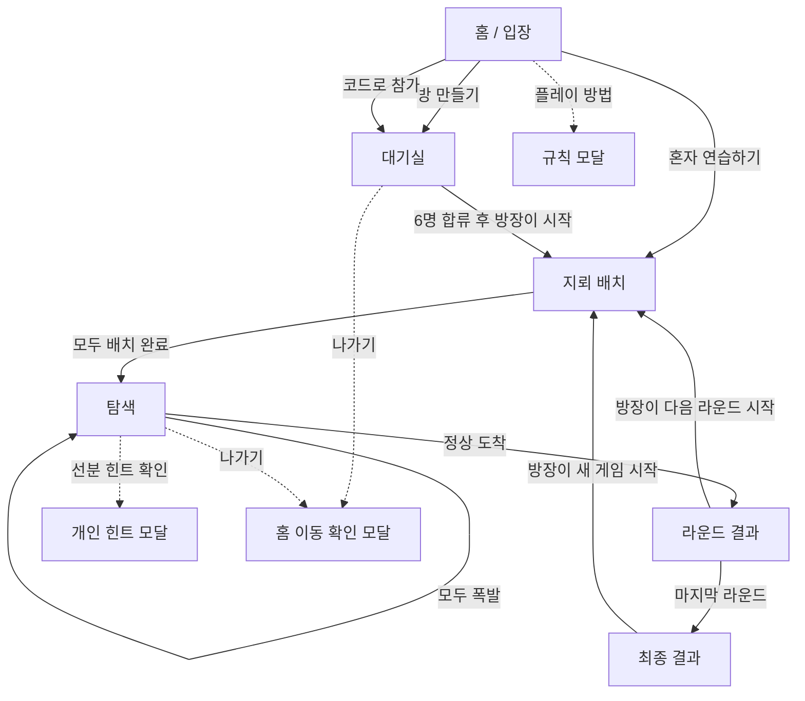

# MindMiner 게임 플로우와 화면 단위 분석

> 이 문서는 초기 2D 화면의 분석 기록이다. 최신 3D 게임의 규칙은 [main 병합 전후 흐름 비교](game/newrule-merge-plan.md)를 참고한다. [이전 3D 게임 검토](game/flow-audit.md)도 병합 전의 기록이다. README는 규칙 근거로 사용하지 않았다.

> 분석 기준: 현재 저장소의 UI와 게임 상태 구현 (`app/page.tsx`, `components/mindminer/`, `lib/game.ts`, `lib/demo.ts`, `lib/contracts.ts`). 이 문서는 현행 동작을 기록한다. 향후 게임 화면 재설계의 출발점으로 사용한다.

## 1. 한눈에 보는 현재 구조

MindMiner는 별도 페이지 라우트 없이 단일 클라이언트 화면에서 홈과 게임 상태를 바꿔 보여주는 6인 턴제 보드게임이다. 사용자가 경험하는 큰 단계는 **입장 → 대기실 → 지뢰 배치 → 탐색 → 라운드 결과 → 최종 결과**다. 탐색 중에는 플레이어 차례, 보드 소유자, 이동·폭발·판 전달 이벤트에 따라 같은 게임 화면의 내용과 조작 가능 상태가 달라진다.

현재 기본 설정은 6명, 7라운드, 라운드당 힌트 코인 3개다. 삼각형 보드는 5개 행으로 고정되어 있으며 밑변에 출발점 5개, 정상 1개가 있다. 판은 배치할 때 본인에게만 보이고, 탐색이 시작되면 각 차례의 현재 판이 모두에게 공개된다. 자신의 판은 탐색할 수 없다.

## 2. 게임 플로우 상세

### 2.1 홈에서 입장

1. 사용자는 이름을 입력하고 `방 만들기`, `코드로 참가`, `혼자 연습하기` 중 하나를 선택한다.
2. 방 참가자는 브라우저에 방 코드와 참가 토큰을 저장한다. 초대 링크는 `?room={코드}`를 포함하며, 이를 열면 코드 참가 탭이 미리 선택된다.
3. 저장된 참가 정보가 있으면 같은 방으로 재접속을 시도한다. 연결할 수 없는 방이거나 토큰이 유효하지 않으면 홈으로 돌아오고 오류 메시지를 보여준다.
4. 데모는 서버 방을 만들지 않고, 플레이어 한 명과 준비 상태의 봇 다섯 명으로 즉시 구성한다. 첫 배치는 사용자가 한다. 데모 진행 상태는 브라우저 메모리에만 존재한다.

### 2.2 대기실

- 방은 6개의 고정 좌석으로 표시된다. 참가자는 입장 순서대로 빈 좌석에 배정된다.
- 초대 코드와 초대 링크 복사, 각 좌석의 플레이어 이름, 방장 표시, 참가 인원이 보인다.
- 6명이 모이기 전에는 시작 버튼이 비활성화된다. 비방장은 방장이 시작하기를 기다린다.
- 방장이 시작하면 첫 탐색자를 무작위로 정하고 지뢰 배치 단계로 넘어간다.

### 2.3 지뢰 배치

- 각 참가자는 자신의 삼각형 보드에서 밑변을 제외한 선분을 눌러 지뢰를 설치하거나 제거한다.
- 안전 경로가 정상까지 하나 이상 남아야 준비 완료 버튼을 누를 수 있다. `랜덤 배치`와 전체 지우기도 제공한다.
- 보드와 설치 개수, 안전 경로 유효성, 준비 인원, 플레이어별 배치 상태가 함께 표시된다.
- 준비를 마친 플레이어의 배치는 잠기며, 모든 플레이어가 준비하면 탐색이 시작된다.
- 첫 탐색 차례는 무작위로 정해지고, 해당 플레이어 자신의 판은 건너뛰어 다음 판부터 탐색한다.

### 2.4 탐색

- 각 플레이어 차례에는 다른 플레이어의 판 하나가 공개된다. 헤더에는 차례 주인, 보드 주인, 현재 라운드가 표시된다.
- 자기 차례인 플레이어는 밑변의 출발점 하나에서 시작한 뒤, 현재 점에 연결된 점으로 이동한다. 지뢰가 터지기 전까지 같은 차례에 연속 이동할 수 있다.
- 안전 이동은 약 650ms 동안 이동 이벤트로 표시된다. 이동이 끝나기 전에는 다음 행동을 할 수 없다.
- 지뢰를 밟으면 말은 사라지고 폭발 위치가 약 1.8초간 보인다. 지뢰는 보드에 남는다. 이벤트가 끝나면 시계 방향 다음 플레이어로 차례가 넘어가고, 새 시도는 출발점에서 시작한다.
- 6명이 모두 실패하면 보드가 왼쪽으로 한 칸 전달된다. 자기 보드가 돌아오는 한 칸은 건너뛰며, 판 전달 안내가 약 1.4초간 표시된다. 이후 같은 라운드의 탐색을 반복한다.
- 자기 차례에 힌트를 켠 뒤 선분을 선택하면 코인 1개를 사용한다. 결과는 본인 전용 모달에만 나타나고 닫으면 UI 상태에서 사라진다. 힌트는 차례나 이동을 소비하지 않는다.
- 정상에 먼저 도달하면 라운드가 끝난다. 승점은 정상 도착 1점과 남은 힌트 코인의 합이다.

### 2.5 결과와 다음 라운드

- 라운드 결과에는 우승자, 점수 계산, 누적 순위가 표시된다. 방장만 다음 라운드를 시작할 수 있고, 다른 플레이어는 기다림 상태를 본다.
- 다음 라운드의 첫 탐색자는 직전 승자의 왼쪽 좌석이다. 점수는 유지하고 코인은 3개로 보충하며, 배치와 탐색 상태는 초기화한다.
- 7라운드가 끝나면 최종 순위와 공동 우승자를 보여준다. 방장은 새 게임을 시작할 수 있으며, 이때 라운드와 점수가 초기화되고 첫 탐색자는 무작위로 정해진다.

## 3. 화면 인벤토리

화면은 라우트 단위가 아니라 `view.phase`에 따른 조건부 렌더링으로 구분된다. 아래에서 **화면**은 큰 진행 단계, **유닛**은 화면 안의 독립된 UI 구역이나 오버레이다.

| ID | 화면 / 유닛 | 진입 조건 | 주요 내용과 조작 | 다음 상태 |
|---|---|---|---|---|
| S0 | 홈 / 게임 입장 | `view`가 없음 | 브랜드 헤더, 플레이 방법, 게임 소개와 보드 일러스트, 방 만들기·코드 참가 폼, 데모 시작, 저장된 방 재접속 | 대기실 또는 배치 |
| S0a | 입장 폼 | 홈 | 생성/참가 탭, 이름 입력, 참가 시 방 코드 입력, 요청 중 로딩 및 오류 문구 | 대기실 또는 홈 오류 |
| S0b | 규칙 모달 | 플레이 방법 클릭 | 5개 규칙 단위: 배치, 이동·폭발, 판 전달, 힌트, 점수·승리 | 닫으면 이전 화면 |
| S1 | 온라인 대기실 | `phase=waiting` | 초대 코드·링크, 6개 좌석, 참가 인원, 방장 전용 시작 버튼 또는 대기 문구 | 배치 |
| S2 | 지뢰 배치 화면 | `phase=placing` | 플레이어/준비 상태 목록, 비공개 보드, 지뢰 배치 도구, 경로 유효성, 준비 완료 수 | 탐색 |
| S3 | 탐색 화면 | `phase=playing` | 플레이어 목록과 현재 차례, 현재 공개 보드, 진행 이벤트, 내 힌트 패널 | 다음 차례/판 전달/라운드 결과 |
| S3a | 개인 힌트 선택 모드 | S3에서 힌트 사용 | 보드 선분을 선택 대상으로 강조하고, 선택 취소 버튼 노출 | 힌트 모달 또는 일반 탐색 |
| S3b | 개인 힌트 모달 | 힌트 응답을 받은 직후, 유효한 현재 차례 | 지뢰 있음/없음 결과, 답을 강조한 보드 미리보기, 닫으면 답변 소멸 안내 | 닫으면 S3 |
| S3c | 이동·폭발 이벤트 오버레이 | 이동/폭발 이벤트 유효 시간 | 말 이동 애니메이션 또는 폭발 표시. 폭발 뒤에는 차례 변경, 판 전달은 안내 오버레이 | S3의 다음 진행 |
| S4 | 라운드 결과 | `phase=roundEnd` | 라운드 우승자와 계산식, 누적 순위, 방장 다음 라운드 버튼 또는 대기 문구 | 다음 라운드 배치 |
| S5 | 최종 결과 | `phase=finished` | 최종 순위와 공동 우승 처리, 방장 새 게임 시작 버튼 | 새 게임 배치 |
| O1 | 홈 이동 확인 모달 | 게임 헤더의 나가기 또는 브랜드 클릭 | 데모 종료 또는 온라인 방 재접속 가능 안내, 계속 플레이/홈 이동 | 이전 상태 또는 홈 |
| O2 | 토스트 | 초대 링크 복사 성공/실패 | 복사 성공 안내 또는 방 코드 안내, 약 2.6초 후 사라짐 | 현재 화면 유지 |
| O3 | 오류·연결 알림 | 입장/액션 실패, 폴링 연결 이상 | 게임 상단 오류 또는 연결 재시도 메시지. 일반 오류는 닫기 가능 | 현재 화면 유지/복구 |

### 공유 프레임

게임 화면(S1–S5)은 공통 사이트 헤더, 게임 상단 바, 오류 알림 자리, 게임 푸터를 공유한다. 상단 바는 현재 단계명과 방 코드/초대 복사 버튼을 보여주며, 대기실을 제외한 단계에는 라운드 진행도를 표시한다. 데모에는 `나 + 봇 5명` 표시가 붙는다.

## 4. 탐색 화면의 구성 단위

탐색과 배치 화면은 동일한 3열 게임 레이아웃을 사용한다. 각 열의 역할은 서로 다르다.

| 영역 | 주요 UI 단위 | 배치 단계 | 탐색 단계 |
|---|---|---|---|
| 좌측: 플레이어 패널 | 좌석 순 플레이어 행, 아바타, 나 표시, 상태/점수 | 배치 중/완료와 준비 체크 | 현재 차례 강조, 누적 점수 |
| 중앙: 필드 패널 | 단계 제목, 공개 범위 배지, 설명, 보드, 보드 주인, 범례, 하단 상태 문구 | 내 이름의 비공개 보드, 배치 선분 클릭 | 현재 보드 주인, 출발점·정상, 말/이벤트, 내 차례에만 유효한 점 클릭 |
| 우측: 액션 패널 | 단계별 행동과 상태 표시 | 설치 수, 경로 유효성, 랜덤/전체 지우기, 준비 버튼, 전체 준비 수 | 남은 힌트 코인, 힌트 시작/취소, 힌트 사용 조건, 라운드·로테이션 정보 |

보드(`components/mindminer/board.tsx`)는 SVG로 그린다. 선분과 점이 키보드 조작 가능한 버튼 역할을 하고, `allowedNodes` 및 현재 행동 모드가 상호작용 대상을 결정한다. 게임 중 지뢰 배열은 일반 보드 컴포넌트에 전달되지 않는다. 화면 이벤트는 서버와 클라이언트 상태의 만료 시각에 따라 잠깐 나타난다.

## 5. 상태와 조작 가능성

| 상태 | 보드에서 가능한 조작 | 우측 액션 | 다른 플레이어에게 보이는 정보 |
|---|---|---|---|
| 대기실 | 없음 | 방장은 6명 모두 합류 후 시작 | 좌석, 이름, 방장, 참가 인원 |
| 배치 중, 본인 미완료 | 밑변 이외 선분에서 지뢰 토글 | 랜덤 배치, 전체 지우기, 안전 경로일 때 준비 완료 | 본인 배치만 본인에게 전달, 준비 여부는 공개 |
| 배치 완료 대기 | 내 보드 입력 불가 | 준비 완료 상태 표시 | 다른 사람의 배치 내용은 비공개 |
| 탐색 중, 타인 차례 | 없음 | 힌트 비활성 안내 | 현재 보드, 현재 차례, 이동/폭발 이벤트, 공개 점수 |
| 탐색 중, 내 차례·미출발 | 출발점 5개 중 하나 선택 | 힌트 사용 또는 대기 | 동일 |
| 탐색 중, 내 차례·이동 중 | 현재 점과 연결된 점만 선택 | 힌트 사용 또는 대기 | 안전 이동이 잠깐 보임 |
| 탐색 중, 내 차례·힌트 선택 | 배치 가능한 선분 선택 | 선택 취소 | 선택 전/후 답은 다른 참가자에게 전달되지 않음 |
| 이벤트 재생 중 | 이벤트 종료까지 행동 차단 | 비활성 | 이동/폭발/판 전달 애니메이션 |
| 라운드 결과 | 없음 | 방장만 다음 라운드 | 우승자, 승점, 누적 순위 |
| 최종 결과 | 없음 | 방장만 새 게임 시작 | 챔피언과 최종 순위 |

## 6. 화면 상태 외곽 조건

- **재접속:** 온라인 참가 토큰은 `localStorage`의 `mindminer.membership.v1`에 저장된다. 세션 복원 중에는 홈 입력을 잠그고, 성공하면 기존 게임 상태로 이동한다.
- **연결 저하:** API 조회는 탐색 중 약 350ms, 그 외에는 약 1초 간격으로 폴링한다. 연결 오류가 나면 재시도 안내를 표시한다. 구현상 별도 연결 끊김 화면은 없다.
- **행동 대기:** 요청 중 버튼과 일부 보드 입력이 잠기며 로딩 상태를 표시한다. 오래 기다리는 동작을 위한 시각적 타이머/취소 흐름은 없다.
- **방 나가기:** 온라인 방에서 홈으로 돌아와도 방과 참가 자리는 유지되고, 같은 브라우저에서 다시 연결할 수 있다. 데모는 나가면 진행이 종료된다.
- **반응형:** 큰 화면에서는 플레이어/필드/액션 3열이다. 중간 폭에서는 플레이어가 위쪽 전체 폭, 필드와 액션이 2열이다. 모바일에서는 플레이어, 필드, 액션을 세로로 쌓고 좌석 카드는 3열로 줄인다. 같은 게임 흐름을 유지하며 별도 모바일 화면 모드는 없다.

## 7. 현행 UI와 README 사이의 차이

현재 코드 기준으로는 아래 동작을 확인했다. `README.md`의 일부 서술은 더 확장된 기능을 설명하지만 이 클론의 현재 코드에서는 찾을 수 없어, 이 문서의 화면 인벤토리에 포함하지 않았다.

| 항목 | 현재 코드 | README 서술 |
|---|---|---|
| 인원/좌석 | 6인 고정, 좌석 6개 | 2–8인, 대기·관전 인원, 좌석 및 정원 조절 |
| 방 설정 | 대기실에서 별도 설정 UI 없음 | 힌트 수, 라운드 수, 그리드 크기 선택 |
| 보드 크기 | 5행 삼각형 고정, 시작점 5개 | 3–6등분 선택 |
| 특수 능력·메모 | 화면과 게임 타입에 구현 흔적 없음 | 능력 선택, 개인 메모 및 능력별 동작 |
| 결과 공개 | 결과 표와 점수 계산 | 모든 플레이어 배치를 열람할 수 있다는 설명 |
| 룩앤필 옵션 | 현재 화면 트리에 테마 선택 UI 없음 | 라이트/다크 모드 설명 |

이 차이는 실제 제품 요구사항일 가능성과 저장소 문서의 오래된 내용일 가능성을 코드만으로 구분할 수 없다. 게임화 작업 전에 현재 코드 동작을 기준으로 우선 화면을 재구성할 수 있으며, README에만 적힌 기능을 포함하려면 별도의 요구사항 확정이 필요하다.

## 8. 게임처럼 느껴지게 바꿀 때 유지해야 할 정보 구조

현재 UI는 `홈 → 페이지 전환 → 3열 대시보드` 구조가 강하다. 게임 화면 재설계 시에도 플레이 상태에서 사용자에게 필요한 핵심 피드백은 계속 식별 가능해야 한다.

1. **내 차례와 현재 행동:** 지금 움직일 수 있는 사람, 시작/이동/힌트 중 가능한 행동, 선택 가능한 보드 대상.
2. **현재 판의 소유자와 공개 범위:** 누구의 판인지, 배치 단계인지 모두에게 공개된 탐색 단계인지.
3. **이벤트 타이밍:** 이동 애니메이션, 폭발 공개 시간, 다음 차례로 넘어가는 순간, 판 로테이션 동안의 입력 잠금.
4. **라운드와 점수 맥락:** 남은 라운드, 현재 누적 점수, 승리 점수 계산, 다음 단계 권한자.
5. **개인 정보의 경계:** 배치 지뢰와 힌트 답은 허가된 플레이어에게만 노출하고, 힌트 모달을 닫은 뒤 답을 화면에 남기지 않는다.

이 다섯 항목은 화면 장식을 바꾸더라도 상태 전이 및 게임 규칙과 연결된 피드백 기준이다. 게임 HUD, 턴 연출, 애니메이션, 전체 화면 보드 등 후속 시각 설계는 이 기준 위에서 결정할 수 있다.

## 9. 주요 구현 위치

- 화면 상태와 상호작용: [`app/page.tsx`](../app/page.tsx)
- 삼각형 보드 SVG: [`components/mindminer/board.tsx`](../components/mindminer/board.tsx)
- 모달 프레임: [`components/mindminer/modal.tsx`](../components/mindminer/modal.tsx)
- 단계/행동/플레이어 공개 범위: [`lib/contracts.ts`](../lib/contracts.ts), [`lib/game.ts`](../lib/game.ts)
- 로컬 데모와 봇: [`lib/demo.ts`](../lib/demo.ts)
- 레이아웃과 반응형: [`app/globals.css`](../app/globals.css)
- 기존 제품 설명: [`README.md`](../README.md)
