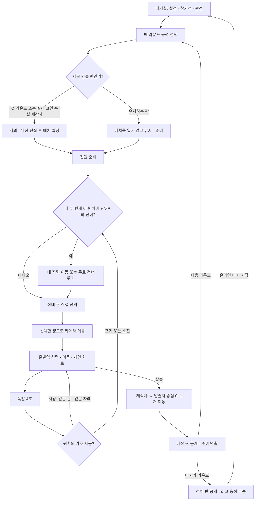

# game → 최신 main 규칙 비교와 병합 계획

> 이후 UI 개선에서 라운드 내 능력 재선택을 금지하고 필수 선택 팝업으로 변경했다. 매 라운드 재선택은 유지한다. 최신 이미지 UI·메모 UX·연출 변경은 [개선 기록](ui-polish-03.md)을 참고한다.

기준: 현재 3D 게임 `game@b8c7dc2`, 최신 원격 `main@7a77775`. README가 아닌 규칙·타입·실제 UI·테스트 코드를 근거로 분석했다. 작업 브랜치는 `game`에서 분기한 `game-newrule`이다.

## 1. 현재 game의 흐름

1. 고정 6명 방 생성·참가 → 방장이 시작. 혼자 연습은 봇 5명.
2. 전원 매 라운드 새 지뢰 배치. 밑변 제외, 안전 경로 필수. 별도 능력·메모 없음.
3. 모두 확정하면 판 자동 전달. 자기 판은 제외. 출발역 5개 중 선택하고 인접점을 양방향으로 이동.
4. 개인 힌트는 선로마다 코인 1개. 라운드마다 3개, 사용 취소는 무료, 답을 닫으면 사라짐.
5. 폭발 1.8초 후 다음 사람. 전원이 실패하면 다시 판 전달. 본인 판이 돌아오는 단계는 건너뜀.
6. 첫 탈출자만 `1 + 남은 힌트`점. 전원 새 배치·코인 보충. 다음 첫 탐색자는 승자 왼쪽.
7. 고정 7라운드 후 최고 누적 점수 우승. 방장 재시작은 즉시 새 배치.

## 2. 최신 main의 흐름

### 방과 준비

- 방장 설정: 참가 2~6명, 힌트 0~10개, 라운드 1~20회, 격자 3~6등분. 대기·관전 포함 최대 32명.
- 빈 참가석 자동 배정. 정원 초과·진행 중 입장은 관전. 대기실에서 방장이 참가석 올리기·내리기 가능. 방장이 관전해도 진행 권한 유지.
- 새 게임은 모두 **승점 코인 3개**로 시작. 힌트 코인과 별개다.
- 매 라운드 각자 능력 선택, 중복 허용. 확정 전 변경 가능. 2인에서는 메모 능력 2종 제외.
- 첫 라운드는 전원 새 판 제작. 이후에는 직전 탈출로 실제 승점 코인을 잃은 제작자만 재배치. 나머지는 기존 배치를 다시 열지 않고 능력 선택 후 준비만 완료.
- 지뢰 상한은 밑변 제외 선로의 절반(내림): 3/4/5/6등분에서 7/13/20/28개. 안전 경로도 유지해야 한다.

### 매 차례: 능력 결정 → 판 선택 → 탐색

1. 두 번째 자기 차례부터 위험의 전이가 있으면 먼저 내 지뢰 이동·건너뛰기를 결정한다.
2. 내 판을 제외한 상대 판 하나를 직접 고른다. 같은 상대를 반복 선택할 수 있다. 선택 전에는 출발·이동·힌트 불가. 선택 후 이번 차례에는 바꿀 수 없다.
3. 출발역 선택 → 인접점 탐색. 격자 크기에 따라 역은 4~7개. 밑변은 안전, 되돌아가기·횡이동 가능. 이동 이벤트 650ms.
4. 힌트는 기본 비용 1개, 위장 선로이면 `판독 불가(null)`도 정당한 답이며 비용은 차감된다.
5. 폭발은 4초. 가호가 남아 있으면 사용/포기 결정 전까지 일반 탐색을 멈춘다. 사용하면 **같은 판·같은 차례**에 출발역부터 재도전. 포기·횟수 소진 시 다음 사람의 판 선택부터 시작.
6. 자동 로테이션은 신규 경기에서 사용하지 않는다. 저장된 구형 방을 위한 기존 로테이션 분기는 서버에 남아 있다.

### 승리와 판 유지

- 탈출 시 상대 판 제작자에게 승점 코인이 있으면 1개를 가져온다. 제작자 0개면 이동량은 0이며 음수가 되지 않는다.
- 힌트를 얼마나 남겼는지는 승점에 영향이 없다. 전원의 승점 코인 합은 보존된다.
- 라운드 결과는 대상 제작자의 판만 공개. 최종 결과에서는 모든 판 공개.
- 다음 첫 탐색자는 직전 탈출자의 왼쪽. 힌트·능력 자원 보충, 메모 초기화, 능력 다시 선택.
- 실제 코인을 잃은 제작자만 새 배치. 이전에 코인 0개인 판을 탈출했다면 재배치 대상이 없다.
- 기존 판의 지뢰·위장은 유지된다. 제작자의 능력이 바뀌어도 기존 위장은 남는다. 유지하는 판에는 위장을 수정할 수 없다.
- 설정된 마지막 라운드 후 최고 승점 코인 보유자가 우승, 동점 공동 우승. 온라인 재시작은 **대기실로 복귀**해 설정·좌석 재조정. 연습 재시작은 바로 새 배치.

## 3. 능력·메모 세부 의미

| 능력 | 행동·자원 | 중요한 경계 |
|---|---|---|
| 잔광의 인도 | 기본 힌트 +2 | 남은 힌트는 승점으로 변환되지 않음 |
| 귀환의 가호 | 라운드당 2개, 폭발 4초 후 선택 | 같은 판·같은 차례로 재출발, 연속 사용 가능, 지뢰는 유지 |
| 기만의 장막 | 새 판 제작 중 선로 최대 4개 위장 | 안전·지뢰 모두 가능, 밑변 금지, 판독 불가도 힌트 비용 발생, 유지 판 수정 금지 |
| 타인의 기억 | 라운드당 2회, 한 번에 기본 메모 슬롯 수 이하 선택 | 다른 사람의 작성된 슬롯만 선택. 내용은 사용 전 비공개, 결과 임시, 자동 메모 저장 없음 |
| 위험의 전이 | 두 번째 자기 차례부터 판 선택 전, 최대 7회 | 내 지뢰 1개를 빈 선로로 옮김. 성공만 횟수 차감, 건너뛰기 무료. 개수·상한·안전 경로 유지 |
| 기억의 각인 | 메모 용량 두 배 | 추측도 기록 가능, 정답 검증·자동 수정 없음 |

기본 메모 슬롯은 2명 0칸 / 3~4명 1칸 / 5~6명 2칸. 메모는 `판 주인 + 선로 + 안전/지뢰/미확인`을 직접 작성·수정·삭제한다. 최신 서버의 `memo`는 탐색 단계라면 남의 차례·연출·능력 결정 대기 중에도 허용한다. 힌트·훔쳐보기·판 선택 같은 일반 행동은 자기 차례와 능력 결정 상태를 엄격히 검사한다.

자원·자기 메모·훔쳐본 답·지뢰 이동용 배치는 본인에게만 전달한다. 남의 메모 수정은 일반 행동의 리비전을 무효화하지 않도록 서버가 별도 버전을 관리한다. 늦은 개인 답은 방·자기 ID·라운드·차례 번호·판 소유자·능력 결정 상태가 달라졌으면 버린다.

## 4. 차이와 3D 구현 대응

| 영역 | 현재 game | 최신 main 반영 |
|---|---|---|
| 판 전환 | 자동 판 전달, 6명마다 회전 | 상대 판 선택 화면과 선택 후 해당 3D 테이블로 카메라 이동 |
| 판 유지 | 매번 전원 재제작 | 재제작 대상만 편집, 나머지는 비공개 유지·준비 |
| 승점 | 탈출 보너스와 힌트 합산 | 3개 지갑, 제작자→탈출자 코인 이동 연출 |
| 특수 능력 | 없음 | 능력 선택·설명, 위장 편집, 가호 결정, 지뢰 이동 결정, 메모·훔쳐보기 |
| 힌트 | 있음/없음 2종 | 판독 불가 포함 3종, 개인 답 수명 강화 |
| 보드 | 고정 4등분 | 3~6등분 실제 선로·출발역·선택·메모 좌표 동기화 |
| 방 | 고정 6인 | 설정·좌석·관전 지원, 관전자 입력 차단 |
| 결과 | 점수 표 | 승점 이동과 공개 허용된 판 열람, 온라인 재시작 대기실 |
| 안내서 | 이전 자동 전달·점수 규칙 | 새 흐름·6능력·판 유지·승점과 일치하도록 전면 수정 |

## 5. 병합 순서

1. 이 문서를 먼저 기록한 후 `origin/main@7a77775`를 `game-newrule`에 실제 Git merge한다.
2. main의 서버 규칙·API·타입·테스트를 기준으로 채택한다. 기존 3D 캔버스 진입점·게임 전용 스타일·이미지 HUD는 유지한다.
3. 가변 보드와 새로운 선택 상태를 월드·세션에 반영한다. 미선택 판에 잘못된 테이블·노드를 표시하지 않는다.
4. 모든 새 조작을 이미지 에셋과 캔버스 HUD로 제공한다. 화면에 HTML 게임 메뉴를 도입하지 않는다.
5. 모바일·키보드 조작, 비공개 결과 수명, 신규 안내서와 결과 연출을 연결한다.
6. 타입·빌드 및 사용자 요청 범위인 규칙/클라이언트 동작을 검증하고, 병합 및 구현 결과를 기록한다.

## 6. 실제 반영 결과

### 플레이 흐름

- **규칙의 기준:** `lib/game.ts`, `lib/contracts.ts`, `lib/demo.ts`, `lib/geometry.ts`, `lib/roles.ts`, `lib/settings.ts`, `lib/room-service.ts`는 `origin/main@7a77775`를 그대로 사용한다. 3D 클라이언트에 따로 규칙을 재구현해 두 기준이 생기지 않도록 했다.
- **새 캔버스 화면:** 방 설정, 참가석·관전 관리, 능력 갤러리, 상대 판 선택, 가호 선택, 지뢰 이동, 개인 메모 작성·삭제, 훔쳐보기 선택·임시 결과, 허용된 판 공개, 코인 이동과 순위 결과. 모두 PNG 아틀라스와 오프스크린 글자 래스터화로 구성한다.
- **기존 그래픽 유지:** 홈 디오라마, 어두운 갱도·텍스처·스포트라이트·수레 조명, 파티클 폭발과 먼지, 자동 카메라, 이미지 버튼의 호버·눌림 에셋을 유지한다. 신규 경기에는 자동 전달이나 섞기 문구를 표시하지 않고, 고른 상대의 테이블로 이동한다.
- **가변 3D 보드:** 3·5·6등분 갱도를 Blender로 추가 제작하고 GLB와 편집 가능한 `.blend`를 포함했다. 기본 4등분의 기존 공간 디자인을 유지하며, 모든 격자에서 선로·플랫폼·선택·메모·미니 지도는 `board-layout.ts` 좌표를 공유한다. 출발역 PNG도 7번까지 제공한다.
- **개인 정보 수명:** 배치가 끝나면 로컬 배치 초안을 지운다. 지뢰 이동에서만 서버가 허용한 `shiftMines`를 사용한다. 힌트·훔쳐본 답은 닫기 또는 라운드·차례·선택 판·능력 결정 상태 변경 시 제거한다. 유지 판을 다시 열어보는 UI는 없다. 메모는 직접 저장한 기록만 복원한다.
- **그래픽 안내:** 15장 안내서에 판 선택·승점·유지 판과 여섯 능력을 각각 설명하는 그림을 추가했다. 능력 갤러리에서 해당 사용법을 바로 열고 돌아올 수 있다. 작은 화면은 스크롤·장 이동 스와이프를 지원한다.
- **호환성:** 서버에 남아 있는 구형 방의 점수·자동 전달 분기는 보존한다. 새 게임·온라인 재시작은 최신 설정과 규칙을 따른다. 병합된 main의 DOM 컴포넌트는 소스로 보존하되 게임 진입점은 기존 단일 WebGL 캔버스다.

### 구현 위치

| 역할 | 파일 |
|---|---|
| 상태 동기화·개인 답 수명·키보드·터치 | `lib/mine/engine.ts`, `session.ts` |
| 새 규칙용 이미지 화면·행동·로컬 편집 상태 | `lib/mine/rule-hud.ts`, `rule-actions.ts`, `rule-ui.ts` |
| 가변 3D 지도·개인 메모 표시·카메라 | `lib/mine/world.ts`, `board-layout.ts` |
| 15장 안내서와 그림 생성 | `lib/mine/guide.ts`, `scripts/design/build_game_guide.mjs` |
| Blender 모델 생성 | `scripts/design/build_game_models.py`, `scripts/build-game-models.mjs` |
| 신규 실제 캔버스 검증 | `tests/game-newrule-canvas.mjs`, `tests/guide-canvas.mjs` |

### 화면 기록

[상대 판 선택](newrule/board-choice.png) · [가호 후 같은 판 복귀](newrule/guardian-return.png) · [코인 이동과 순위](newrule/victory-transfer.png) · [가로 결과](newrule/victory-landscape.png) · [모바일 결과](newrule/victory-mobile.png) · [능력 그래픽 안내](newrule/guide-recorder.png) · [모바일 능력 안내](newrule/guide-recorder-mobile.png)

## 7. 검증 범위

- main에서 가져온 규칙·기하·연습·인증 서비스 테스트 **140개 통과**. 0코인 탈출, 유지되는 위장, 역할 변경, 동시 행동, 개인 응답, 구형 저장 방 호환성을 포함한다.
- TypeScript 검사와 전체 ESLint 통과. main에서 함께 들어온 보존용 DOM 컴포넌트의 React 상태 초기화 및 테스트의 `const` 경고만 정리했으며, 위의 규칙 엔진 파일은 수정하지 않았다.
- 실제 3D 캔버스 검증은 `tests/game-newrule-canvas.mjs`로 수행한다. 역할 선택에서 출발해 판 선택 전 훔쳐보기, 무료 힌트 취소, 위장의 유료 판독 불가, 가호 재출발, 차례 밖 메모, 전이 건너뛰기와 실제 이동, 승점·공개 범위·유지 판·재시작, 방 설정·좌석·관전, 가변 보드를 확인한다.
- `tests/guide-canvas.mjs`에서 15개 안내 장, 스크롤·장 이동·스와이프, 배치·힌트 키보드 조작, 연습 중 안내서 읽기, 회전 후 GPU 텍스처 크기를 확인했다. 1440×900, 390×844, 320×568, 844×390 뷰포트 통과.
- 브라우저 검증은 로컬 Chromium과 실제 API를 사용하며 화면에 HTML 버튼·카드가 없는지도 확인한다. 실제 iOS/Android 기기 성능·브라우저별 차이는 이번 검증 범위에 포함하지 않았다.

실제 캔버스 전체 시나리오와 최종 2인 설정·관전 재검증 모두 통과했으며 JavaScript·셰이더·게임 에셋 로딩 오류는 없었다. 추가 화면: [판 선택 전 훔쳐보기](newrule/peek-before-board.png), [모바일 메모](newrule/memo-mobile.png), [6등분 갱도](newrule/grid-6.png), [2인 모바일 6등분](newrule/two-player-mobile.png), [모바일 대기실](newrule/lobby-mobile.png), [참가석 관리](newrule/roster-mobile.png).

프로덕션 빌드도 통과했다. 번들러의 500kB 초과 청크 안내와 vinext의 API 경로 정적 분류 안내는 남아 있으며 빌드 오류는 아니다.
